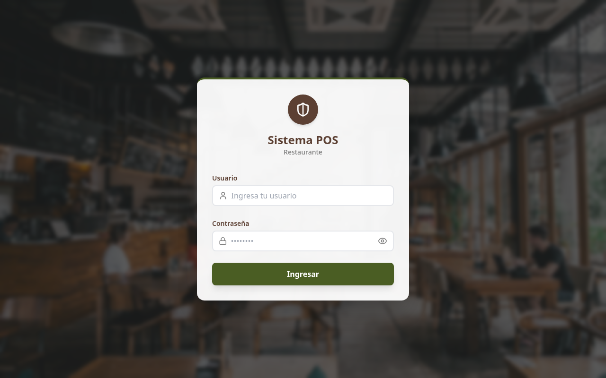
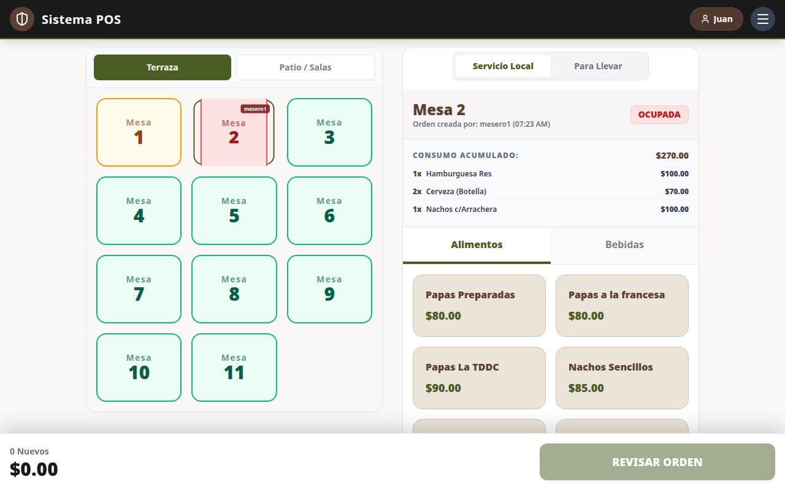
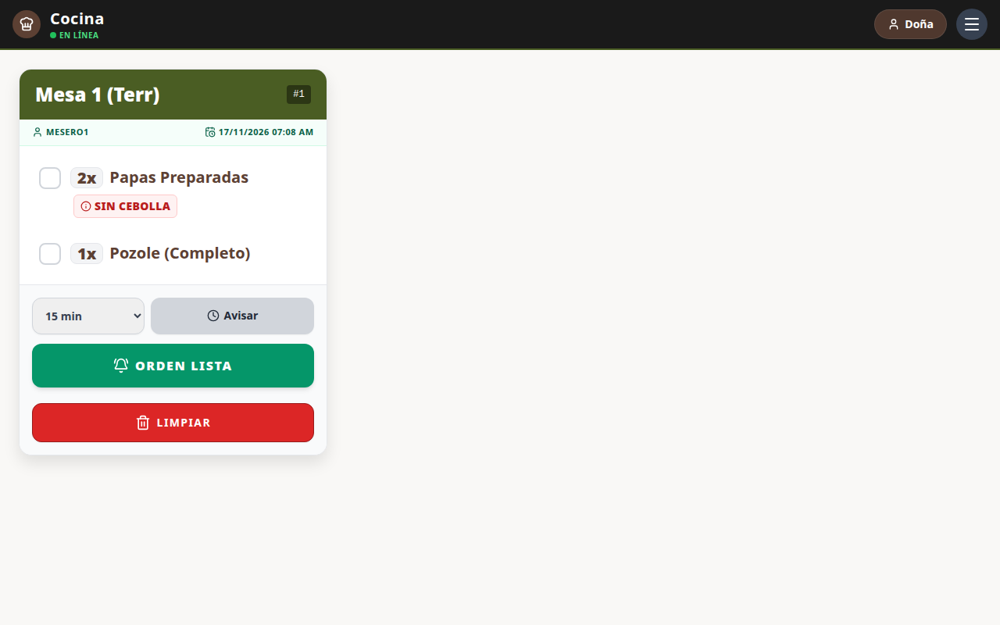
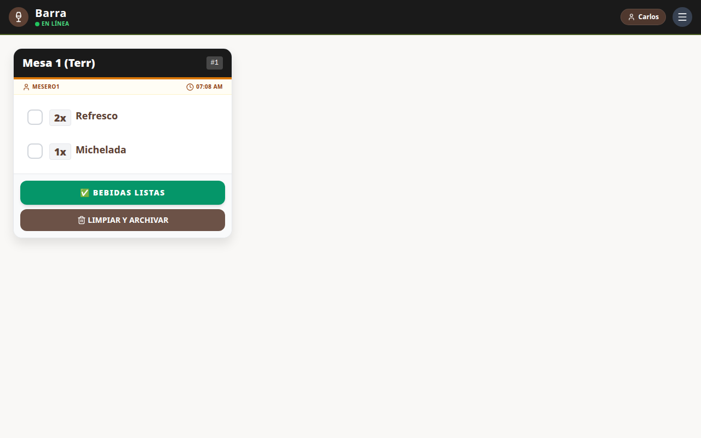
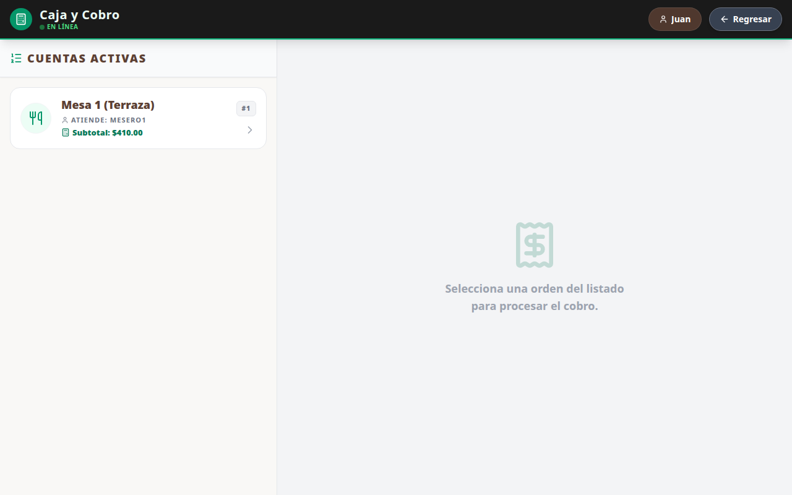
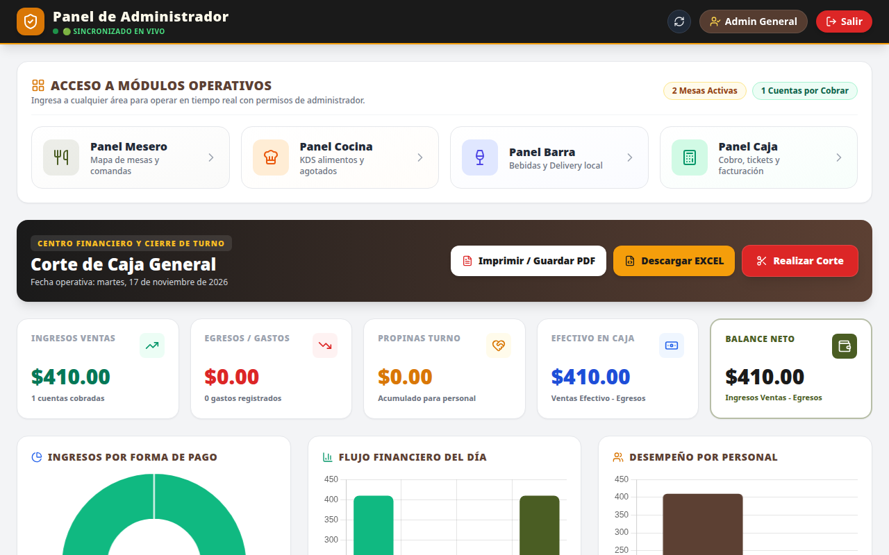
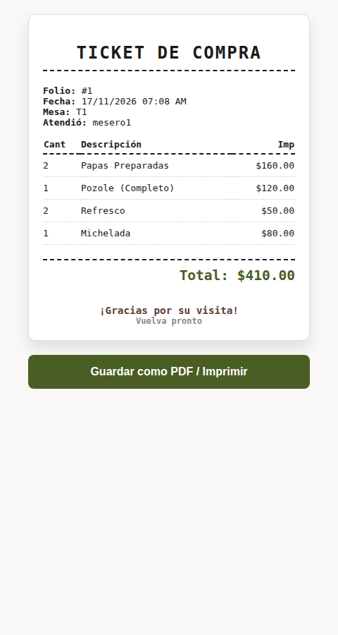
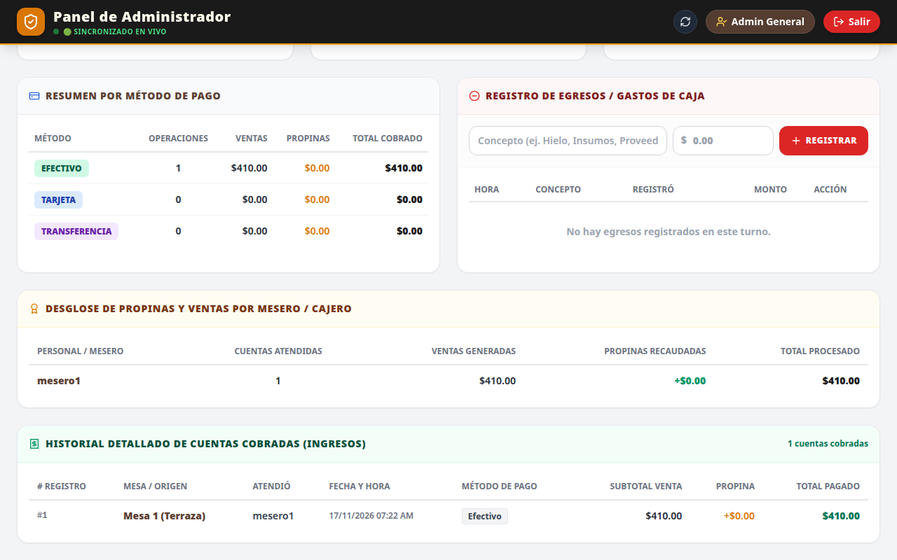
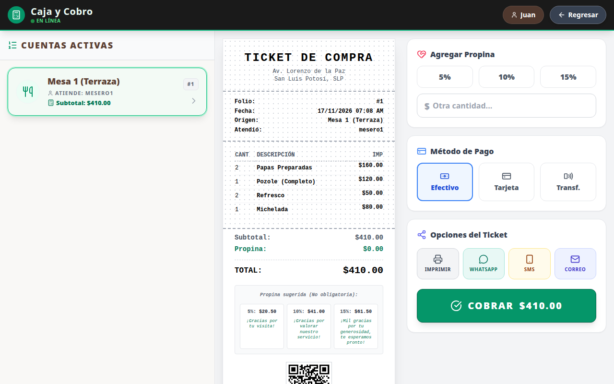

# Sistema POS Restaurante

Sistema punto de venta (POS) para restaurante, para uso local en red. Gestiona mesas, comandas, cocina, barra, caja y administración, con actualización en tiempo real entre paneles.

## Qué hace

- **Mesero:** ve mesas libres/ocupadas, arma comandas por mesa o para delivery, agrega productos y notas.
- **Cocina:** recibe en tiempo real las comandas de alimentos, marca items como listos y avisa tiempos de preparación.
- **Barra:** recibe las comandas de bebidas, despacha tickets por mesa y lleva historial de barra.
- **Caja:** consulta cuentas pendientes, genera ticket digital con QR, cobra (efectivo, tarjeta o transferencia), registra propinas y egresos, y hace corte de caja.
- **Administrador:** panel de administración y corte, con historial de caja, egresos y reportes.

El backend expone una API REST y un WebSocket (`/ws/comandas`) para notificar nuevas comandas, despachos, pagos y cambios de mesa sin recargar.

## Tecnologías

- **Backend:** Python 3.14, FastAPI, SQLAlchemy, SQLite, Uvicorn, websockets
- **Frontend:** HTML, CSS y JavaScript vanilla, Tailwind CSS por CDN, Lucide, Chart.js
- **Base de datos:** SQLite (`restaurante.db`, se genera en local)

## Estructura

```text
backend/
  main.py          # API FastAPI, WebSockets y rutas de caja, cocina y barra
  models.py        # Modelos SQLAlchemy: mesas, productos, órdenes, usuarios, historiales
  database.py      # Conexión a SQLite
  productos.py     # Script para cargar/actualizar el catálogo de productos
  usuarios.py      # Script para crear los usuarios iniciales
  limpiar_db.py    # Borra la base de datos local para recrearla
frontend/
  login.html       # Entrada al sistema, redirige al panel según el rol
  index.html       # Vista integral antigua (mesero / cocina / caja), se conserva en el repo; no funciona con las rutas actuales del backend
  app.js           # Lógica de la vista integral antigua
  panel_mesero.html
  panel_cocina.html
  panel_barra.html
  panel_caja.html
  panel_admin.html
docs/
  screenshots/     # Capturas de demostración de cada panel
  ejemplos/        # Reporte de corte (PDF y Excel) y ticket de ejemplo
  manuales/        # Manual de Usuario y Manual del Programador (PDF)
```

## Cómo correrlo en local

### 1. Backend

```bash
cd backend
python -m venv env
env\Scripts\activate        # Windows
# source env/bin/activate   # macOS / Linux
pip install -r ../requirements.txt

python usuarios.py    # crea los usuarios iniciales
python productos.py   # carga el catálogo de productos
uvicorn main:app --reload --port 8000
```

La API queda en `http://127.0.0.1:8000` y su documentación interactiva en `http://127.0.0.1:8000/docs`.

Si necesitas empezar de cero, corre `python limpiar_db.py` y luego vuelve a correr `productos.py` y `usuarios.py`.

### 2. Frontend

Abre `frontend/login.html` en el navegador (por ejemplo con Live Server de VS Code). Inicia sesión y el sistema te lleva a tu panel según tu rol.

El frontend se conecta al backend usando el mismo host del navegador en el puerto 8000, así que en la misma red local también funciona desde otra computadora o celular poniendo la IP de la computadora del servidor.

## Usuarios iniciales

Los usuarios de prueba se crean con `backend/usuarios.py`. La contraseña inicial de todos es `123`:

| Usuario | Rol | Contraseña |
| --- | --- | --- |
| admin1, admin2, admin3 | administrador | 123 |
| mesero1, mesero2, mesero3 | mesero | 123 |
| cocina1, cocina2 | cocinera | 123 |
| bar1, bar2 | bartender | 123 |

> Las credenciales iniciales son solo para demostración en local. Cámbialas antes de usar el sistema en un entorno real: las contraseñas se guardan en texto plano en este proyecto.

## API (principales)

| Método | Ruta | Descripción |
| --- | --- | --- |
| POST | `/api/login` | Inicia sesión y devuelve el rol |
| GET | `/api/productos` | Catálogo de productos |
| GET | `/api/mesas` | Mesas y su estado |
| POST | `/api/mesas/{mesa_id}/comanda` | Crea o agrega items a una comanda |
| GET | `/api/cocina/pendientes` | Comandas pendientes de cocina |
| GET | `/api/barra/pendientes` | Comandas pendientes de barra |
| GET | `/api/caja/pendientes` | Cuentas pendientes de cobro |
| GET | `/api/cuenta/{orden_id}` | Detalle de una cuenta |
| POST | `/api/pagar/{orden_id}` | Cobra una cuenta |
| GET | `/api/ticket/{orden_id}` | Ticket digital en HTML |
| POST | `/api/propinas` | Suma, resta o corta propinas |
| DELETE | `/api/caja/corte` | Corte de caja del día |
| WS | `/ws/comandas` | Notificaciones en tiempo real |

## Notas

- El archivo `restaurante.db` no está en el repositorio: se crea automáticamente al iniciar el backend y se llena con los scripts de `productos.py` y `usuarios.py`.
- El backend permite CORS desde cualquier origen (`allow_origins=["*"]`), pensado para uso en red local. No lo expongas directamente a internet sin autenticación y HTTPS.
- `index.html` y `app.js` son una vista integral antigua que llama rutas que ya no existen (`/mesas/{id}/cuenta`, `/mesas/{id}/cobrar`, `/cocina/despachar/{id}`); despachar, ver la cuenta y cobrar no funcionan desde ahí. La entrada real del sistema es `login.html`, que redirige a los paneles según el rol.

## Capturas de demostración

Capturas del sistema corriendo en local, con dos comandas demo: la orden #1 en la mesa T1 (Mesa 1, Terraza) — 2× Papas Preparadas, 1× Pozole (Completo), 2× Refresco y 1× Michelada, total $410.00, cobrada en efectivo — y la orden #2 en la Mesa 2 — 1× Hamburguesa Res, 2× Cerveza (Botella) y 1× Nachos c/Arrachera, total $270.00, pendiente de cobro, que es la que se ve en la captura del panel mesero.

### Inicio de sesión



### Panel mesero



### Panel cocina



### Panel barra



### Panel caja



### Panel administrador



### Ticket digital



### Administrador: corte de caja



### Caja: cobro de la cuenta



## Archivos de ejemplo

Archivos reales generados por el sistema con la comanda demo (mesa T1, total $410.00, cobrada en efectivo):

- [Reporte de corte de caja (PDF)](docs/ejemplos/Reporte_Corte_Caja_ejemplo.pdf): reporte generado desde el panel de administrador con el botón "Imprimir / Guardar PDF".
- [Reporte de corte de caja (Excel)](docs/ejemplos/Reporte_Corte_Caja_ejemplo.xlsx): el mismo reporte en Excel, con 5 hojas (resumen general, formas de pago, rendimiento personal, cuentas cobradas y egresos).
- [Ticket de compra (PDF)](docs/ejemplos/Ticket_ejemplo.pdf): ticket generado desde caja para la orden demo.

## Manuales

- [Manual de Usuario (PDF)](docs/manuales/Manual_de_Usuario.pdf): guía paso a paso para el personal del restaurante (mesero, cocina, barra, caja y administrador), con capturas de cada panel.
- [Manual del Programador (PDF)](docs/manuales/Manual_del_Programador.pdf): instalación, arquitectura, estructura del proyecto, orden de los archivos y secuencia de ejecución, API REST, WebSocket y solución de problemas.
